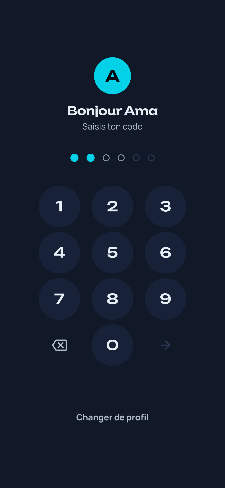
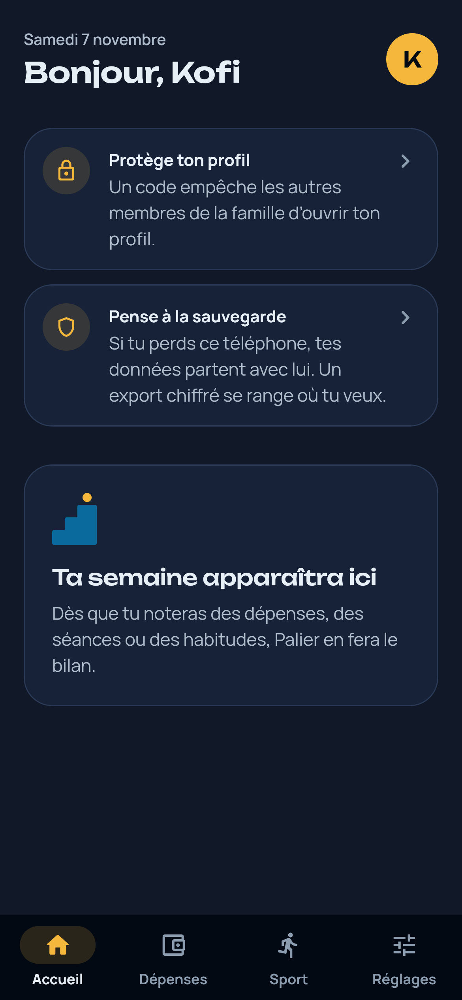
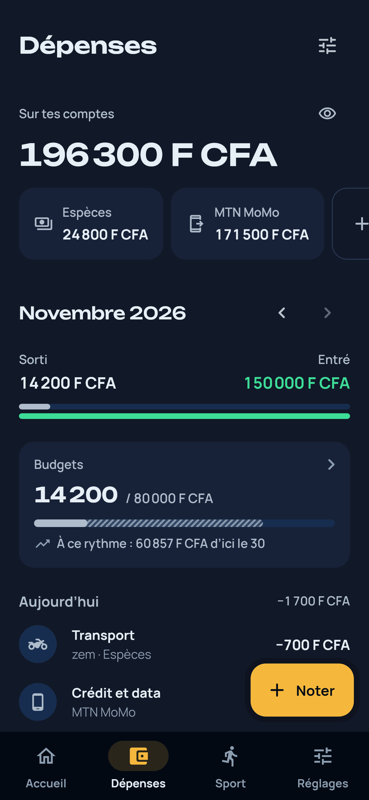
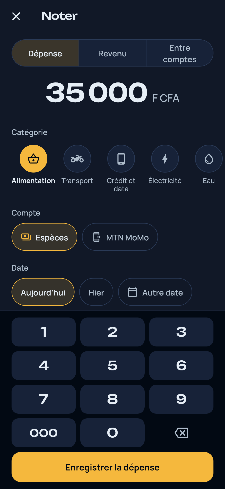
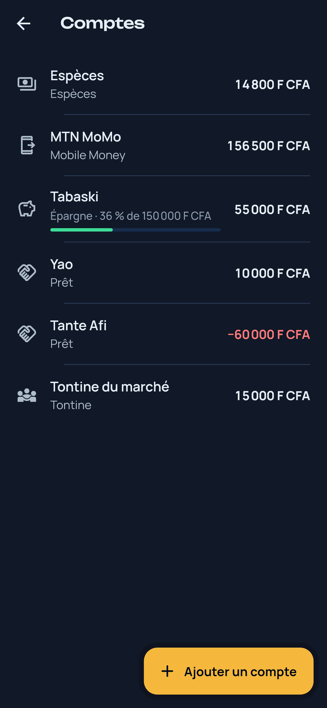
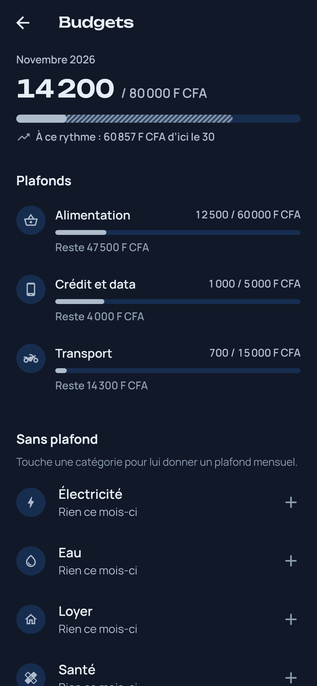

<p align="center">
  
</p>

# Palier

Suivre ses dépenses, son sport et ses habitudes, en famille, marche après marche. Palier est une
application Android open source qui garde **toutes les données sur le téléphone** : pas de compte,
pas de serveur, pas de publicité.

<p align="center">
  
  
  
</p>

<p align="center">
  
  
  
</p>

<p align="center">
  
</p>

## Ce que fait Palier

Chaque membre de la famille a son profil : son prénom, sa couleur, sa devise, les modules qu'il
suit, et son propre verrou.

| Lot | Contenu | État |
|---|---|---|
| 1. Socle et profils | Profils personnalisés, profil d'enfant, code à 4-6 chiffres avec blocage progressif, empreinte, verrouillage après une minute en arrière-plan, export et import chiffrés | Fait |
| 2. Dépenses | Saisie rapide, comptes (espèces, Mobile Money, banque), budgets, dépenses récurrentes, prévision de fin de mois, épargne, tontines et prêts | En cours : saisie, comptes, catégories, soldes, budgets et prévision faits |
| 3. Sport | Programme selon les réglages du profil, séances guidées, suivi des progrès | À venir |
| 4. Progression | Habitudes, objectifs par étapes, bilan de la semaine | À venir |
| 5. Options Android | Lecture des SMS Mobile Money (désactivée par défaut), nombre de pas | À venir |

Le module sport ne donne aucun conseil médical ni nutritionnel. Un profil d'enfant n'a ni poids, ni
calories, ni mensurations.

## Vie privée

- **Hors ligne.** Les données vivent dans une base SQLite, dans le dossier privé de l'application.
  La sauvegarde automatique d'Android vers le cloud est désactivée
  (`android/app/src/main/res/xml/data_extraction_rules.xml`).
- **Un verrou par profil.** Le code est conservé sous forme d'empreinte PBKDF2-HMAC-SHA256, jamais
  en clair. Après 5 essais manqués, le profil se bloque 30 s, puis le blocage double à chaque échec,
  jusqu'à 15 min. L'empreinte digitale est facultative ; l'écran prévient que toute empreinte
  enregistrée sur le téléphone pourra ouvrir le profil.
- **Export chiffré.** Un profil s'exporte dans un fichier `.palier` chiffré en AES-256-GCM, avec une
  clé dérivée du mot de passe choisi (PBKDF2-HMAC-SHA256, 210 000 itérations). Le format est décrit
  dans [`backup_codec.dart`](lib/features/backup/domain/backup_codec.dart).

## Construire l'application

Prérequis : Flutter stable (Dart 3.13 ou plus récent) et le SDK Android.

```bash
flutter pub get
dart run build_runner build      # code de la base (drift), après une modification des tables
flutter analyze
flutter test
flutter build apk --release
```

Les captures de `docs/captures/` sont des tests de rendu, hors de la suite normale :

```bash
flutter test --tags captures --run-skipped --update-goldens
```

## Organisation du code

```
lib/
  app/          thème, routes, état partagé (Riverpod), application
  core/         sécurité (code, empreinte), composants d'interface communs
  data/         base SQLite (drift)
  features/     un dossier par fonctionnalité : profiles, backup, home, settings…
  l10n/         textes de l'interface (app_fr.arb)
branding/       identité visuelle : symbole, icônes, couleurs (voir branding/LISEZMOI.md)
```

Toutes les tables suivent les mêmes conventions (identifiant UUID, dates UTC, suppression douce),
pour permettre plus tard une synchronisation entre les téléphones d'une même famille.

Palier s'appuie sur [`lucid_core_flutter`](https://pub.dev/packages/lucid_core_flutter) pour son
thème, ses boutons, ses cartes et ses états vides.

## Contribuer

Les tickets et les propositions sont les bienvenus. Avant d'ouvrir une demande de fusion :
`dart format .`, `flutter analyze` sans aucun avertissement, et `flutter test`. Les messages de
commit suivent [Conventional Commits](https://www.conventionalcommits.org/fr/), en français.

## Licence

Code sous licence [Apache 2.0](LICENSE). Polices embarquées sous licence SIL Open Font License :
[Unbounded](assets/licenses/OFL-Unbounded.txt) et [Manrope](assets/licenses/OFL-Manrope.txt).
